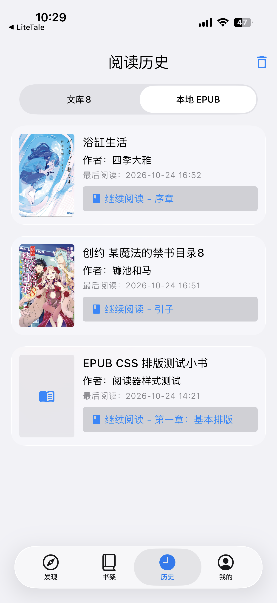
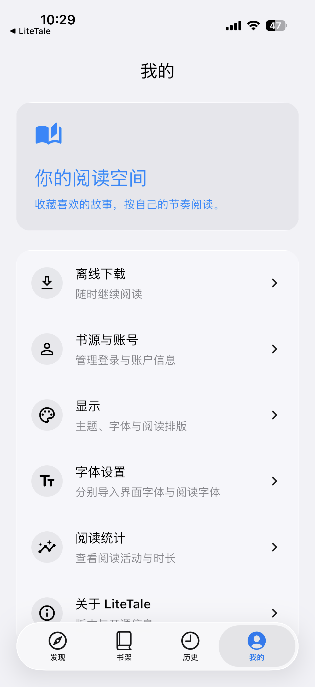
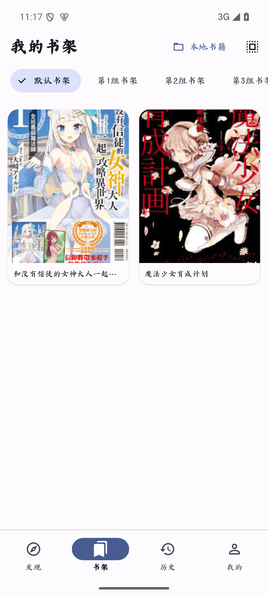
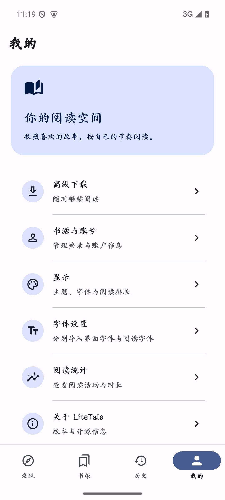

<div align="center">
  
  <h1>LiteTale</h1>
  <p>基于 Wild 的 Android 与 iOS 轻小说阅读器</p>

[](LICENSE)
[](https://github.com/metaMMY07/LiteTale/releases)
[](https://github.com/metaMMY07/LiteTale/releases)
</div>

> **开发公告（2026-10-25）**：因本人课业较为繁重，LiteTale 暂缓开发。欢迎使用者继续提出建议，帮助改进软件。

## 最新正式版 LiteTale 1.1.0（2026-10-26）

[下载 Android ARM64 APK（build 77）](https://github.com/metaMMY07/LiteTale/releases/download/v1.1.0/LiteTale-1.1.0%2B77-arm64-v8a.apk) · [下载 iOS IPA（build 18，未签名）](https://github.com/metaMMY07/LiteTale/releases/download/v1.1.0/LiteTale-1.1.0-ios-18-unsigned.ipa) · [发布说明](https://github.com/metaMMY07/LiteTale/releases/tag/v1.1.0)

本版内置幻梦轻小说书源，更新 Android Material You 卡片与底部毛玻璃栏，并更新 iOS 原生配色、液态玻璃和书源导入体验。iOS IPA 需自行签名后侧载；本次 Android 仅提供 ARM64 包。

## LiteTale 1.0.0

LiteTale 1.0.0 提供 Android ARM64 手机／平板版、x86_64 模拟器版和 iOS 版。在线轻小说与本地 EPUB 书籍可以在同一书架管理。

[下载 ARM64 手机／平板版 APK](https://github.com/metaMMY07/LiteTale/releases/download/v1.0.0-build75/LiteTale-1.0.0-build75-arm64-v8a.apk) · [下载 x86_64 模拟器版 APK](https://github.com/metaMMY07/LiteTale/releases/download/v1.0.0-build75/LiteTale-1.0.0-build75-x86_64.apk) · [下载 iOS IPA（未签名）](https://github.com/metaMMY07/LiteTale/releases/download/v1.0.0-build75/LiteTale-1.0.0-ios-13-unsigned.ipa) · [查看正式发布说明](https://github.com/metaMMY07/LiteTale/releases/tag/v1.0.0-build75)

完整功能和安装包校验值见 [1.0.0 发布记录](docs/releases/1.0.0.md)。

### 界面预览

展示 iOS 与 Android 端的主要界面。

<table>
  <tr>
    <td align="center"><br>发现</td>
    <td align="center"><br>阅读历史</td>
    <td align="center"><br>我的</td>
  </tr>
  <tr>
    <td align="center"><br>发现 · Android</td>
    <td align="center"><br>书架 · Android</td>
    <td align="center"><br>我的 · Android</td>
  </tr>
</table>

### 功能

- 在哔哩轻小说、文库8、轻书架与轻小说百科之间切换，也可以导入自定义规则书源；各书源的账号、书架和阅读记录分别保存。
- 支持 EPUB 2/3 图文书：Android 可在应用内离线阅读并保留常见原书 CSS；iOS 可将原书交给 Apple Books 阅读。
- 支持搜索、书籍详情、目录与阅读；增加哔哩轻小说原站读取和验证恢复入口，并持续改进文库8与轻书架的读取稳定性。
- iOS 使用系统配色和液态玻璃控件；Android 保留原有 Material You 界面。Android 支持平板横屏双页和仿真翻页，iOS 使用普通翻页。
- 分别导入全局界面字体和阅读字体，支持 TTF／OTF；加密章节继续使用书源所需字体，避免乱码。
- 书源导入支持 LiteTale JSON 和 Legado JSON 的部分 CSS／JSON 规则；不执行外部脚本。

APK 使用与既有版本相同的 Android Debug 签名，适合直接安装和从同签名版本升级；目前不用于 Google Play 等商店分发。

## 构建

项目需要 Flutter、Rust 与 Flutter Rust Bridge 对应的构建环境。Windows 本机构建入口：

```powershell
powershell -ExecutionPolicy Bypass -File tools/build_android.ps1
```

Android 构建说明见 [ANDROID.md](ANDROID.md)，版本历史见 [CHANGELOG.md](CHANGELOG.md)。

## 来源与许可

- 本项目基于 [Wild](https://github.com/niuhuan/wild) 修改，Wild 及其衍生代码按 [GNU GPL v3](LICENSE) 发布。
- Windows 应用图标来自 [celia-sh/Novella](https://github.com/celia-sh/Novella)，按 [GNU AGPL v3](LICENSES/AGPL-3.0.txt) 许可使用。
- 内置霞鹜新致宋 Plus 字体按字体文件声明的 [IPA Font License v1.0](LICENSES/IPA.txt) 使用。
- 详细来源和修改范围见 [THIRD_PARTY_NOTICES.md](THIRD_PARTY_NOTICES.md)。

分发或继续修改本项目时，请保留原作者、上游项目和许可证声明，并按相应许可证提供源代码及字体许可文本。

## 责任声明

1. 本项目仅供学习和研究使用。
2. 本项目不存储小说内容，内容由第三方站点提供。
3. 使用者应自行遵守所在地法律及内容站点的服务条款。
4. 本项目及贡献者不对使用本软件产生的后果承担责任。
